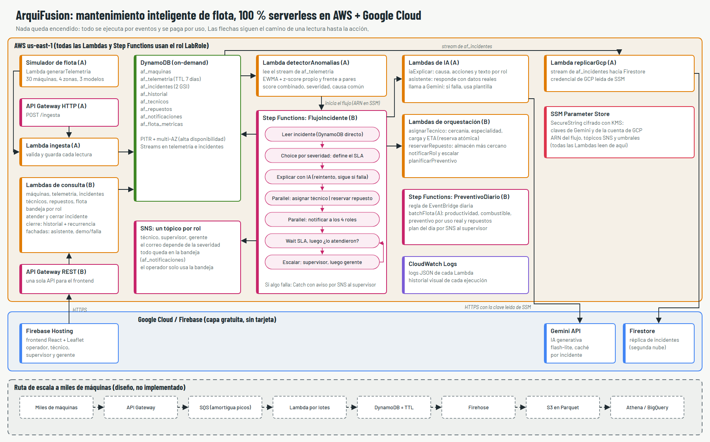

# ArquiFusion: mantenimiento inteligente de flota

Plataforma 100 % serverless que convierte la telemetría de maquinaria pesada en acciones: detecta anomalías combinadas, abre el incidente, lo explica con IA, asigna al técnico más adecuado, reserva el repuesto, avisa a cada rol con su propio mensaje y escala si nadie lo atiende. Corre en **AWS** (Lambda, API Gateway, DynamoDB, Step Functions, EventBridge, SNS, SSM) y **Google Cloud** (Gemini para la IA, Firestore y Firebase Hosting).



| Carpeta | Contenido |
|---|---|
| `infra-base/` | Tablas `af_*` (PITR, streams, TTL), tópicos SNS por rol y parámetros SSM |
| `datos-ia/` | Simulador, ingesta, detector de anomalías, IA generativa con Gemini (si falla, plantilla fija), analítica de flota, réplica a Firestore |
| `plataforma/` | Step Functions `FlujoIncidente` y `PreventivoDiario`, Lambdas de orquestación y API REST |
| `frontend/` | React + Vite + Leaflet, publicado en Firebase Hosting |

## Despliegue (en este orden)

Requisitos: Node 20+, Python 3.12+, AWS CLI v2 con las credenciales del Learner Lab. Se usa Serverless Framework v3 con `npx`. En Git Bash, antes de los comandos con rutas `/arquifusion/...`, ejecuta `export MSYS_NO_PATHCONV=1`.

```bash
cd infra-base && npx serverless@3 deploy --stage dev                 # 1. datos y parámetros
cd ../datos-ia                                                      # 2. IA y segunda nube (valores en SSM)
aws ssm put-parameter --name /arquifusion/ia_proveedores --type String --value gemini --overwrite
aws ssm put-parameter --name /arquifusion/gemini_model --type String --value gemini-3.5-flash-lite --overwrite
aws ssm put-parameter --name /arquifusion/gemini_api_key --type SecureString --value "<clave>" --overwrite
aws ssm put-parameter --name /arquifusion/gcp_service_account --type SecureString --value file://clave.json --overwrite
./build_layer.sh && npx serverless@3 deploy --stage dev && python scripts/seed.py   # 3. parte de datos e IA
cd ../plataforma && npm install && npx serverless deploy --stage dev # 4. orquestación y API (anota la URL)
cd ../frontend && cp .env.example .env.local                         # 5. pega la URL en VITE_API_URL
npm install && npx firebase-tools login && npx firebase-tools use --add && npm run deploy
```

## Probar el flujo completo

1. Enciende el simulador: `python datos-ia/scripts/demo.py correr 900`.
2. En el frontend, «Simular falla» sobre `M-017` (rodamiento, 3 min). En 3 a 4 minutos aparece el incidente. La ejecución se ve en la consola de Step Functions y los correos llegan por rol (suscríbete con `python datos-ia/scripts/demo.py suscribir tu@correo`).
3. Marca el incidente «en atención» o espera el SLA para ver el escalamiento. Ciérralo y revisa el historial de la máquina.
4. Preventivo diario a mano: `aws stepfunctions start-execution --state-machine-arn arn:aws:states:us-east-1:<cuenta>:stateMachine:arquifusion-dev-preventivo-diario`.

## Costo y seguridad

- Nada queda encendido. El simulador y la regla diaria vienen apagados (`simuladorActivo`, `preventivoEstado`). DynamoDB es on-demand, la telemetría expira a los 7 días y los `Wait` de Step Functions no cobran.
- La IA usa Gemini: Amazon Bedrock no está habilitado en el AWS Academy Learner Lab (`AccessDenied` también con `LabRole`). Se eligió un modelo *lite* porque los modelos con razonamiento tardaban más de 30 s.
- Secretos y variables globales en **SSM Parameter Store** (SecureString con KMS). El repositorio no contiene claves: `clave.json` y `.env*` están en `.gitignore`.
- Pruebas locales sin AWS: `python plataforma/tests/test_core.py`, `python datos-ia/tests/test_core.py`.
